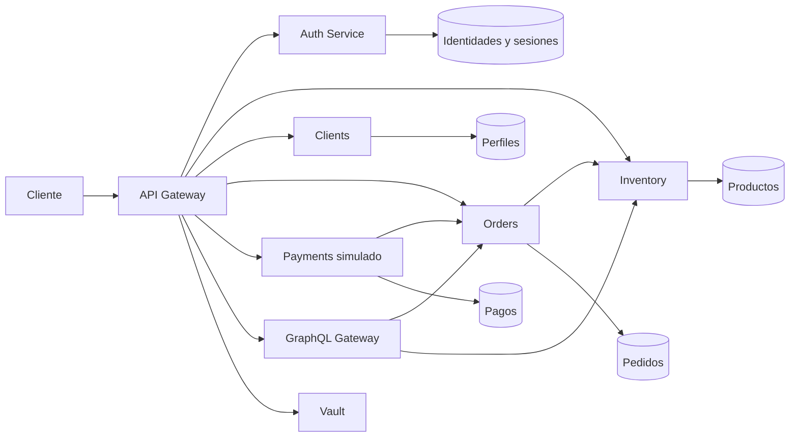
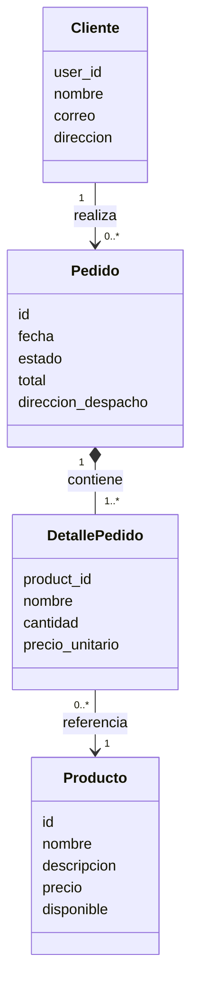

# Arquitectura del backend

El backend incluye `inventory`, `orders`, `clients`, `payments`, el API Gateway y GraphQL. El frontend todavía no está conectado.

Cada almacén es una base MongoDB lógica. Las flechas representan las llamadas implementadas, no una garantía de aislamiento de red. Los servicios se prueban en localhost.

## Entidades de negocio

El pedido guarda una copia del nombre y precio en el momento de la compra. La relación con producto se representa mediante un identificador, sin compartir la base entre servicios.

## Detalles de implementación

- El gateway usa tokens opacos y consulta al Auth Service; no implementa validación JWT.
- GraphQL consulta órdenes e inventario por HTTP y no lee directamente sus bases.
- Payments consulta y actualiza el pedido mediante la API de Orders.
- El registro coordina Auth Service y Clients a través del gateway; puede reintentarse ante una interrupción.
- El frontend, disponibilidad de stock en cantidades, reservas y pagos reales no forman parte de esta implementación.
